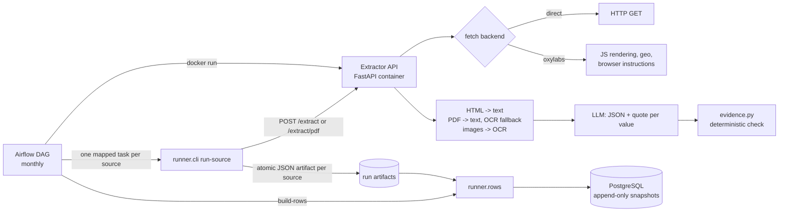

# grounded-scraper

LLM-based extraction of structured values from web pages and PDFs, where **every value
must be backed by a literal quote from the document fetched in that same run**. Values
that cannot be confirmed become `null` and are recorded with a reason, so a gap in the
data is visible instead of hidden behind a confident wrong number.

It ships as a small FastAPI service, a dependency-free runner, and an Apache Airflow
DAG that runs each source as an isolated task and loads one auditable row per
source × record × month into PostgreSQL.

> Generalized from a production pipeline I built at a fintech to track publicly
> published rates monthly. The company-specific source catalog, prompts, database
> schema, per-institution rules and all credentials were removed; the architecture,
> the evidence checks and the operational design are the same.

## Why

Scraping public financial pages breaks constantly: values live in JavaScript-rendered
cards, in images of tables, or in PDFs whose text layer skips the one table that
matters. One brittle script per site does not scale, and an LLM alone will happily
"read" a value from its training data. This project keeps the LLM's flexibility and
removes the guessing:

1. **The LLM proposes** each value together with a short literal quote.
2. **Deterministic code decides**: every number in the value must appear in the quote
   *and* in the text fetched today (or in OCR of today's images). The field's keywords
   must appear in the source. Otherwise the value is nulled.
3. **Nothing is silently dropped**: a failed or partial source still produces rows,
   with a status (`captured`, `unavailable`, `page-changed`) and a one-line diagnostic.

## Architecture



| Piece | What it does |
|---|---|
| `app/fetch.py` | `direct` HTTP by default; optional Oxylabs backend for JS rendering, browser instructions and geo-location. |
| `app/text.py` | Merges trafilatura's Markdown with the page's structural text (values often sit in styled `div`s trafilatura drops). Long pages are cut to windows around record names and field keywords. |
| `app/images.py` | Picks the images most likely to hold the values (help-center attachments first, logos skipped), OCRs them with Tesseract, and sends them to the model in `multimodal` mode. |
| `app/extraction.py` | Builds the JSON schema and prompt from the request, calls the LLM, validates, and does a second independent image reading when fields are still missing. PDFs fall back to rendering + OCR when their text layer lacks the field keywords. |
| `app/evidence.py` | The deterministic gate. Pure standard library, shared with the runner. |
| `runner/` | Reads the source catalog, calls the API per source trying each configured mode in order, writes one atomic JSON artifact per source, and turns a run's artifacts into rows. |
| `dags/grounded_scraper_dag.py` | Starts a per-run container, health-checks it, maps one task per source, loads rows with `ON CONFLICT DO NOTHING`, collects logs and always stops the container. |

### Design decisions

- **Isolation per source.** Each source is its own Airflow task with its own retries;
  one changed page never blocks the rest of the month's snapshot.
- **Failures are data.** The API returns `200` with `status: "failed"` for a source
  failure, and the runner writes it down and exits 0. Only unexpected exceptions fail
  the task and trigger Airflow's retry with exponential backoff.
- **Idempotency.** Artifacts are keyed by period, Airflow run id and source, written
  atomically, and verified on read (an artifact from another run is not trusted).
  Rows are append-only with a unique `(source, record, period)` grain.
- **No silent coercion.** `"30% to 45%"` is stored raw and as a `[min, max]` range,
  never collapsed into one number; formulas such as `"base rate + 5"` stay raw.
- **Secrets stay out of logs.** Credentials are passed to the container by variable
  name (`docker run -e NAME`), never in an argv; errors carry only exception class
  names; `/health` never makes a billable upstream call.

## Catalog

Sources and fields live in a JSON file (see [`examples/sources.example.json`](examples/sources.example.json)):

```json
{
  "fields": [
    {"name": "monthly_price", "kind": "number", "keywords": ["price", "month", "$"]},
    {"name": "plan_summary", "kind": "text"}
  ],
  "sources": [
    {
      "source_id": "example_pricing_page",
      "url": "https://example.com/pricing",
      "records": ["Starter", "Pro"],
      "aliases": {"Pro plan": "Pro"},
      "modes": ["text", "multimodal"],
      "instructions": "Use monthly billing prices, not the yearly discount."
    }
  ]
}
```

A source succeeds only when every record comes back with at least one verified value;
otherwise the next mode is tried (`text`, then `multimodal`).

## Run it

```bash
python -m venv .venv && . .venv/bin/activate
pip install -e ".[dev]"
pytest                      # 58 offline tests: no network, LLM or database
```

Run the API locally (needs an Anthropic API key):

```bash
cp .env.example .env        # fill LLM_API_KEY
docker build -t grounded-scraper .
docker run --env-file .env -p 8000:8000 grounded-scraper
curl -s localhost:8000/health
curl -s localhost:8000/extract -H 'content-type: application/json' -d '{
  "url": "https://example.com/pricing",
  "records": ["Starter", "Pro"],
  "fields": [{"name": "monthly_price", "kind": "number", "keywords": ["price", "$"]}]
}'
```

Run one source with the runner:

```bash
python -m runner.cli --sources-file examples/sources.example.json \
  run-source --source-id example_pricing_page --period 2026-11-01 --run-id manual --data-dir ./data
python -m runner.cli --sources-file examples/sources.example.json \
  build-rows --period 2026-11-01 --run-id manual --data-dir ./data
```

### Airflow

1. Create the table with [`sql/schema.sql`](sql/schema.sql) and an Airflow connection
   `grounded_scraper_db`.
2. Put the catalog where the worker can read it (`GROUNDED_SOURCES_FILE`).
3. Give the worker access to the Docker daemon and the variables from `.env.example`.
4. Backfill a month with `{"period": "2026-10-01"}` as the run configuration.

## Tech

Python 3.11+, FastAPI, httpx, trafilatura, BeautifulSoup, pypdf, Tesseract/poppler,
Anthropic Messages API, Apache Airflow (TaskFlow, dynamic task mapping), PostgreSQL
(JSONB), Docker, pytest, ruff.
